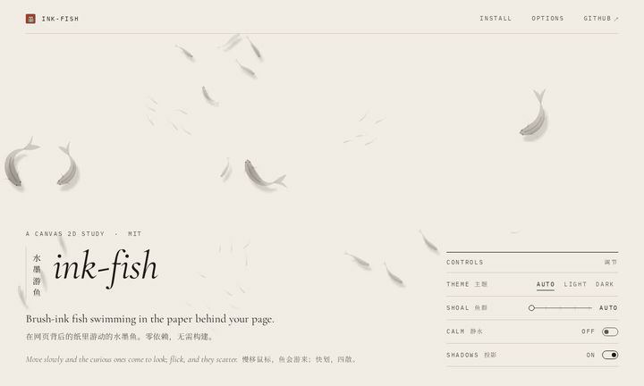
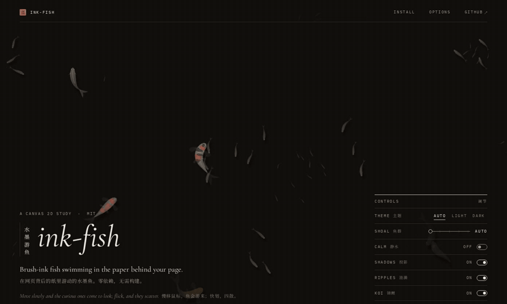

# ink-fish · 水墨游鱼

**中文** | [English](#english)

在网页背后的“纸”里游动的水墨鱼。一张 Canvas 2D、一个 `requestAnimationFrame` 循环，零依赖、无需构建，一个 `<script>` 标签即可使用。纯装饰：不接收鼠标事件，对读屏软件隐藏。

最初是 [zh-blog-mirrors](https://github.com/BreakDimbo/zh-blog-mirrors) 首页书架背后的动效，这里抽出来做成独立的小库。

| 浅色 | 深色 |
| --- | --- |
|  |  |

在线演示：打开 [`index.html`](index.html)（本地直接双击即可，或部署到 GitHub Pages）。

## 用法

```html
<link rel="stylesheet" href="src/ink-fish.css">
<script src="src/ink-fish.js"></script>
<script>
  // 整页背景（画布固定在视口）
  var fish = InkFish.mount(document.body, {
    fixed: true,                 // 水池不动，页面在它上面滚动（默认 false：带滚动视差）
    ripples: true,               // 鼠标下极淡的水波纹（默认 false）
    water: "real",               // 真实水面（WebGL2，默认 false）；不支持时自动退回 Canvas 2D
    koi: true,                   // 几尾彩色锦鲤（默认 false）
    obstacles: ".card",          // 鱼会绕开这些元素，且元素下方不画墨
    text: "h1, .intro",          // 文字下方的墨色会变淡
    title: "h1"                  // 大鱼给标题让路
  });

  fish.set({ theme: "dark" });   // 运行时修改选项
  fish.destroy();                // 移除画布和所有监听
</script>
```

也可以挂在任意元素上（“局部水池”模式：画布随元素滚动，元素滚出视口时暂停）：

```js
InkFish.mount(document.querySelector("#pond"), { count: 14 });
```

或者不写 JS，用 data 属性自动初始化（属性值为可选的 JSON 选项）：

```html
<body data-ink-fish>
<div data-ink-fish='{"count": 20, "theme": "dark"}'></div>
```

页面需要同时引入 `src/ink-fish.css`（淡入、打印隐藏、`isolation` 层叠上下文）。

## 选项

| 选项 | 默认值 | 说明 |
| --- | --- | --- |
| `count` | `"auto"` | 鱼的数量。`"auto"` 按可游区域面积计算；数字为总数（约 62% 小鱼 / 30% 鲤鱼 / 8% 锦鲤）；或 `{ minnow, carp, koi }` |
| `density` | `1` | `"auto"` 时的面积系数 |
| `theme` | `"auto"` | `"auto"` / `"light"` / `"dark"`。auto：先看 `<html data-theme>`，否则跟随 `prefers-color-scheme` |
| `ink` | `{ light: "#1e1c19", dark: "#e8e2d8" }` | 页面正文颜色（单个 hex 或分主题）。宿主元素上的 CSS 变量 `--ink-fish-ink` 优先 |
| `opacity` | `1` | 墨色整体透明度系数 |
| `shadow` | `1` | 灯下投影的透明度系数，`0` 关闭投影 |
| `koi` | `false` | 彩色锦鲤：红白（kohaku）、丹顶（tancho）、山吹（yamabuki）、昭和（showa），用低饱和的朱砂与赭石“设色”。`true` 按宽度 3–6 尾（移动端 2 尾），或填数字；在 `count` 之外另加。注意与 `count.koi`（大的墨色鱼）不同；开启后墨色大鱼会相应减少 |
| `ripples` | `false` | 鼠标下的水波纹：每移动 ≥120px 且间隔 ≥340ms 才起一圈（不是每次 mousemove），点击起一圈略强的；触屏只在轻点时起。每圈三道波前，内坡一线暗、外坡一线亮，低对比、慢衰减，最多同时 5 圈；经过鱼时会让鱼身轮廓轻微折射、并把鱼轻推开。减少动态效果时关闭 |
| `trail` | `true` | 开着 `ripples` 时，按住拖动画出一条长水纹（线源，v1.3.1）；`false` 关闭。减少动态效果时关闭 |
| `water` | `false` | `"real"`：真实水面（v1.3）。一层 WebGL2 画布：波纹按毛细–重力色散 ω² = gk + (σ/ρ)k³ 从一点扩散（Cauchy–Poisson 环：中心静、短波跑在前面、最细的先消失），鱼和投影随水面斜率折射，池底有极淡的焦散光斑，波峰有一点 Fresnel 反光，深处的鱼略偏冷。`ripples` 仍控制鼠标波纹是否出现；只开 `water` 时只有极轻的环境涌浪。没有 WebGL2 / 浮点渲染目标、上下文丢失、或 `adaptive` 判断设备太慢时，自动退回 Canvas 2D 的平面水（`instance.water` 为 `"fallback"`）；减少动态效果时也用平面水。`ripples: "real"` 是 `ripples: true, water: "real"` 的简写 |
| `fixed` | `false` | 整页模式：`true` 时水池固定在视口，页面在其上滚动（无视差，可游区域即视口）；`false` 保持 v1.0 的滚动视差 |
| `adaptive` | `true` | 若帧持续迟到（慢设备光栅化大画布）：开着真实水面时，按 60 帧（或 2 秒）窗口的帧间隔中位数判断——先试一档更便宜的水面（每 CSS px 1 像素），明显变快就保留；仍然慢、或低于约 25 fps 且降档无效时，试一个窗口的平面水，确实更快才退回平面水（v1.3.1）。只是被 30 Hz 省电模式或页面本身拖慢时不降级，之后按 10 s、20 s…2 min 退避再测。退回会在本标签页记住 30 分钟（`sessionStorage` 键 `ink-fish:water-fallback`）。没开真实水面时：一次性降到 DPR 1，并简化锦鲤笔触 |
| `reducedMotion` | `"auto"` | `"auto"` 遵循 `prefers-reduced-motion`；`true` 始终“静水”模式；`false` 忽略 |
| `interactive` | `true` | 是否响应鼠标、点击、快速滚动 |
| `obstacles` | `""` | 选择器：绕行 + 擦除下方墨迹 |
| `bands` | `""` | 选择器：整行宽的水平“墙”（如工具栏），只绕行不擦除 |
| `text` | `""` | 选择器，或 `[{ selector, keep, feather }]`：文字下墨色变淡（`keep` 默认 0.24，`feather` 默认 30px） |
| `title` | `""` | 选择器：大锦鲤给它让出空间 |
| `hero` | `""` | 选择器：锦鲤只在它底部以上（桌面 +160px，移动端 +40px）活动 |
| `habitat` | `""` | 选择器（整页模式）：可游区域到此元素底部为止，默认 `<body>` |
| `ignore` | `"a,button,input,select,textarea,label,[data-ink-fish-ignore]"` | 在这些元素上点击不会惊鱼（`obstacles` / `bands` 自动加入） |
| `mobileQuery` | `"(max-width: 720px)"` | 匹配时使用移动端的数量与尺寸 |
| `maxDpr` | `1.5` | 设备像素比上限 |
| `fadeIn` | `true` | 首次出现时 2.4s 淡入 |

v1.1 新增的 `fixed`、`ripples`、`koi` 默认都关闭，v1.0 的用法与外观不变；唯一的结构变化是投影改为独立画布，宿主里会多一个 `canvas.ink-fish--shadow`（在主画布之前）。演示页三者都打开。

v1.3 新增的 `water` 默认关闭，不开时外观与 v1.2.1 完全相同；开启后宿主里多一个 `canvas.ink-fish--water`（在主画布之后），两张 2D 画布仍在后台绘制、作为纹理上传，但不显示。演示页开启了 `water: "real"`。

返回的实例：`{ canvas, stats, fish, running, water, layout(), set(opts), destroy() }`（`stats.dpr` 为当前画布 DPR；`water` 为 `"real"` / `"flat"` / `"fallback"`；v1.3.1 起 `stats.wq` 为真实水面的档位 0/1，`stats.gw` 为累计的 GPU 工作量计数、`stats.trail` 为当前水纹点数，供 QA 用）。`set({ koi })` 会让锦鲤淡入/淡出，不会打乱鱼群。`layout()` 用于页面结构变化但没有 resize 时重新测量。

## 渲染原理

- **一张画布、一个循环**：整页模式下画布 `position:fixed` 铺满视口，DPR 上限 1.5；固定步长 1/60 s 的模拟 + rAF 绘制。标签页隐藏、宿主滚出视口、或视口里没有空白水面时循环暂停，滚动/鼠标会唤醒。布局只在 resize / reflow 时读取，帧内不触碰 DOM。
- **三层景深**：远处小鱼、中层鲤鱼、近处大鱼，由远到近绘制。默认各自有滚动视差（`y − scrollY·(0.55+0.45·depth)`）；`fixed: true` 时水池静止、页面在其上滑过，滚动只移动“挖空”区域，不移动画布、不触发布局。
- **脊椎与身体波**：每条鱼 11 节脊椎，跟随头部轨迹，每个关节最多弯 ~11°，急转弯是弧线而不是折叠。一条从头到尾的正弦波叠加在脊椎法线方向，尾鳍摆频与速度、推力相关，小鱼更快。
- **冲刺—滑行节奏**：短暂发力后长时间滑行；转向有角速度上限并做缓动。
- **群游**：同种鱼之间做分离 / 对齐 / 聚合（boids），并用两条不可公度的慢正弦做漫游，轨迹不重复。
- **交互**：鼠标快速划过会惊散附近的鱼；静止的鼠标会吸引好奇的鱼过来“看一看”；点击空白处惊鱼；快速滚动像一股水流。
- **水墨质感**：身体是沿脊椎的二次贝塞尔轮廓，线性渐变让墨在头部和背脊积聚、向尾部化开；鳍和尾更淡；鲤鱼和锦鲤有一笔背脊线和眼睛，锦鲤尾鳍有细鳍条。
- **便宜的软阴影**：投影画在一张独立的 1/4 分辨率画布上，由合成器放大，插值得到柔边，不用 blur 滤镜，主画布也不用每帧做整幅放大拷贝。两张画布都提升为独立合成层（`will-change: transform; contain: strict`），重绘画布不会重绘页面；尺寸真正变化时才重新分配画布（移动端地址栏伸缩不会触发）。
- **水波纹**：每圈是三道向外扩散、逐渐减速的波前，内侧一道极淡的冷灰暗线（两道略微错位叠成，所以一侧稍粗、一侧稍细）、外侧一道极淡的亮线，像水面的斜坡（暗色模式下这道亮线是极淡的冷白，在近黑底上与浅色模式一样克制）；经过鱼时按径向把鱼的脊椎点推移 1–2px，形成折射感。
- **真实水面（`water: "real"`）**：四个 WebGL2 pass。① 每个活着的波纹按波数求和出径向剖面 η(r)、dη/dr：Cauchy–Poisson 解 η = Σ F(k,t)·J0(kr)，源谱 k·e^(−k²a²/4)，相位 ω(k)·t，ω² = gk + (σ/ρ)k³（σ/ρ = 7.4e-5，取自 Ultra Water），粘性衰减 e^(−2νk²t)；Bessel 表在 CPU 上算一次（Abramowitz & Stegun 多项式），每帧只上传 8×192 个谱值。时间放慢到 0.22 倍、尺度 0.6 mm/px，所以一个波长约 28px、像慢镜头里的一滴水。② 半分辨率的水面：十六道色散平面波组成的环境涌浪（Tessendorf 式谱，方向张开成扇形，焦散是网而不是织纹）加上各个波纹，同时算出障碍/文字处的遮罩。③ 焦散用 Evan Wallace 的面积比法：一张每 6px 一个顶点的网格（先在一个网格内对斜率做盒式预滤波，避免年轻波纹的短波长被三角形“打成虚线”）按斜率折射到池底，每个三角形输出“原面积 / 新面积”并叠加，所以光只是被重新分配（均值 1）；斜率用三次 B 样条采样，再在半分辨率上按天空张角做一点半影模糊（至少一个网格宽），不会出现珠子状亮点。④ 合成：鱼按斜率 × 浅深度、投影按斜率 × 池底深度各自偏移采样（折射），池底被焦散照亮，Beer–Lambert 透射让深处的鱼略偏冷，最后叠一层 Schlick Fresnel 反射的柔和天空（F0 = 0.02）；陡峭的波峰再带一点偏冷的天光（远离天顶的天空更亮；深色主题里明显些，浅色主题只有一点），深色下焦散压得很淡。折射采样不越过画布边缘，输出带 ±½ 级的抖动以免 8 位色带。浅色、深色各有一套参数，随主题渐变。输出是预乘的“纸 × (1−a) + rgb”，页面背景照样透出来。不用辉光、粒子、色散或抖动。
- **锦鲤**：与墨鱼同一套笔墨。色块定义在“身体坐标”里（沿脊椎 s、横向 t），轮廓由几组按鱼随机播种的谐波生成分瓣与细碎的笔触边，每帧沿脊椎映射，所以花纹随身体弯曲、越过背脊被身体轮廓裁切，每尾都不一样。每块颜料依次画：柔和晕边、主色、干后更深的水痕边、更浅的中心、细颗粒（预渲染的噪点图案）。丹顶是略不规则的椭圆；山吹的金色沿脊背更深、向腹侧变浅；昭和白底朱红，墨则是几笔真正的笔触：从体侧起笔、越过背脊，笔肚饱满、行笔变窄，收笔处散成几缕干笔飞白，并按身体轮廓裁切。背鳍是一片细长、前宽后收的淡墨。胸鳍和尾鳍长而半透明、带细鳍条，尾鳍在转身时滞后摆动；头部更钝，带一对淡淡的须。暗色模式下颜料压低、只给白色一点提亮，不发光。锦鲤转弯半径更大、速度缓慢起伏。
- **障碍与文字**：`obstacles` 区域用 `destination-out` 擦除；`text` 区域附近按距离平滑降低墨色。
- **主题**：浅色是暖调的墨，深色是略暖的浅墨；切换主题时 500ms 渐变过渡。
- **减少动态效果**：`prefers-reduced-motion` 下鱼几乎静止，约每秒绘制 10 次；没有波纹，真实水面也退回平面水。

性能参考（在 zh-blog-mirrors 首页实测）：平均约 0.6 ms/帧；1440px 宽时 57 条鱼，390px 宽时 30 条。演示页（固定水池 + 锦鲤 + 波纹，headless Chromium）：1440px 约 0.8 ms/帧（58 条），390px 约 0.5 ms/帧（31 条）；锦鲤与波纹合计约 +0.2 ms/帧（帧持续偏慢时 `adaptive` 会同时简化锦鲤）。滚动测试：4× CPU 降速、1440px 时平均帧间隔从 47.6 ms 降到 19.6 ms，长任务从 69 个降到 0。

v1.3.1 打磨：
- 鼠标波纹更安静：慢移动每 ~130px 一个细环；快速划过时源点更稀、一个比一个弱，合成一道平静的尾迹。同时存在的波纹有总强度预算，最多 5 个，旧的在 0.8 s 内淡出而不是被截断。点击仍是一个完整的环。
- 深色主题：焦散减半，改为波峰上一线偏冷的天光。锦鲤：深色下去掉背上叠出的那道浅色细带；昭和的干笔丝只在笔尾出现，不再划过红斑；关掉 `koi` 时锦鲤约 0.6 s 淡出（原 1.7 s）。
- 每帧更省：水面 / 焦散 / 半影三个 pass 只在有波纹、滚动或布局变化时每帧跑，否则约 30 Hz；波纹剖面只算活着的行；焦散网格 4px → 6px（顶点约少 2.25 倍）；合成从每像素 9 次纹理采样降到 4 次（模糊挪到半分辨率）。鱼画布每帧仍需上传（鱼每帧都在动）。
- 按住拖动画出一条长水纹（新选项 `trail`，默认 `true`，需开 `ripples`）：真实水面下是一条线源——波前与笔画平行，向两侧扩散、按同样的毛细–重力色散衰减，笔画上每一点有自己的年龄，先画的先散；鱼在其下折射。平面水面下是两侧各一道随时间外推、渐淡的细线。悬停仍是原来的轻柔波纹。不拦截点击和选字（画布仍是 `pointer-events: none`，只在 window 上监听 pointer 事件，从链接、按钮、文字等 `ignore`/障碍上按下不会起水纹）。触屏不 `preventDefault`：竖向滑动仍是滚动、不画；按住约 250 ms 后再拖，或起手明显横向时才画；浏览器接管手势（`pointercancel`）时水纹就在那里结束。注意：默认 `touch-action` 下移动端浏览器会在第一次移动后接管任何平移，所以触屏只会留下很短的一笔（短于 48px 的直接丢弃）；想在触屏上画完整水纹，给水面区域加 `touch-action: pan-y`（竖向滚动照常，横向拖动和按住后拖动交给水纹）。
- `adaptive` 的判断见上表。API 不变。

v1.3 真水（`water: "real"`）：不开时与 v1.2.1 持平（1440px、4× CPU 滚动，晚帧 5–9% 对 6–7%，库内 ~2.8–2.9 ms/帧）。开启后多出的主要是 GPU 开销：每帧四个 pass，并把两张 2D 画布上传为纹理。本机测试环境没有 GPU，headless Chrome 用 SwiftShader 在 CPU 上软件光栅化 WebGL，强制开启时 1440px 约 150 ms/帧、390px 约 41 ms/帧，这个数字不代表真实显卡，只能说明软件渲染下跑不动；`adaptive`（默认开）会在约 30 帧内退回扁平水面，之后与 v1.2.1 基本相同。详见 `qa/demo-r6/perf.md`。

## 浏览器支持

需要 Canvas 2D、`requestAnimationFrame`、`ResizeObserver`、`MutationObserver`、`matchMedia().addEventListener`（局部水池模式另需 `IntersectionObserver`）。即当前的 Chrome / Edge / Firefox，以及 Safari 14+ / iOS 14+。不支持 Canvas 的环境下 `mount()` 返回 `null`，页面不受影响。`water: "real"` 另需 WebGL2 与 `EXT_color_buffer_float`，缺少时自动用平面水。打印时隐藏。演示页已在无头 Chromium 中验证。

## 致谢

真实水面的方法来自：[Ultra Water](https://github.com/Humpalumps/Ultra-Water)（Humpalumps，MIT：Cauchy–Poisson 波纹、毛细色散常数、B 样条焦散、Beer–Lambert、Fresnel）、Evan Wallace 的 WebGL 实时焦散（面积比法）、Jerry Tessendorf《Simulating Ocean Water》（色散与波谱）。只借用了方法，没有复制代码，详见 [THIRD_PARTY_NOTICES.md](THIRD_PARTY_NOTICES.md)。

## 许可证

[MIT](LICENSE) © 2026 BreakDimbo

---

<a id="english"></a>

## English

Brush-ink fish swimming in the "paper" behind your web page. One Canvas 2D, one `requestAnimationFrame` loop, zero dependencies, no build step — a plain `<script>` tag. Purely decorative: it never takes pointer events and is hidden from screen readers.

It started life behind the bookshelves on the [zh-blog-mirrors](https://github.com/BreakDimbo/zh-blog-mirrors) homepage and is extracted here as a standalone library. Previews are above; the demo is [`index.html`](index.html) (works opened locally or on GitHub Pages).

### Usage

```html
<link rel="stylesheet" href="src/ink-fish.css">
<script src="src/ink-fish.js"></script>
<script>
  // whole-page background: the canvas is fixed to the viewport
  var fish = InkFish.mount(document.body, {
    fixed: true,                 // the pond stays put; the page scrolls over it (default false: parallax)
    ripples: true,               // faint water rings under the cursor (default false)
    water: "real",               // real water surface (WebGL2, default false); falls back to Canvas 2D
    koi: true,                   // a few painted koi (default false)
    obstacles: ".card",          // fish swim around these, and no ink is drawn under them
    text: "h1, .intro",          // ink thins under this text
    title: "h1"                  // the big fish give the headline room
  });

  fish.set({ theme: "dark" });   // change options at runtime
  fish.destroy();                // remove the canvas and every listener
</script>
```

Mount on any element for a local "pond" (the canvas scrolls with the element and pauses while it's off screen):

```js
InkFish.mount(document.querySelector("#pond"), { count: 14 });
```

Or auto-init with a data attribute (the value is optional JSON options):

```html
<body data-ink-fish>
<div data-ink-fish='{"count": 20, "theme": "dark"}'></div>
```

Include `src/ink-fish.css` as well (fade-in, hidden in print, `isolation` stacking context). `require("./src/ink-fish.js")` also works for bundlers (CommonJS); otherwise it sets `window.InkFish`.

### Options

| Option | Default | Description |
| --- | --- | --- |
| `count` | `"auto"` | Number of fish. `"auto"` scales with the open swimming area; a number is a total (≈62% minnows / 30% carp / 8% koi); or `{ minnow, carp, koi }` |
| `density` | `1` | Area multiplier for `"auto"` |
| `theme` | `"auto"` | `"auto"` / `"light"` / `"dark"`. Auto reads `<html data-theme>`, else `prefers-color-scheme` |
| `ink` | `{ light: "#1e1c19", dark: "#e8e2d8" }` | Your page's text colour (one hex or per theme). A `--ink-fish-ink` CSS variable on the host wins |
| `opacity` | `1` | Multiplies the ink alpha |
| `shadow` | `1` | Multiplies the lamp-shadow alpha; `0` turns shadows off |
| `koi` | `false` | Painted koi — kohaku, tancho, yamabuki, showa — in muted cinnabar and ochre washes. `true` = 3–6 by width (2 on mobile), or a number; added on top of `count`. Not the same as `count.koi` (the large ink fish); with painted koi on, there are fewer of those |
| `ripples` | `false` | Water rings under the cursor: one per ≥120px and ≥340ms of travel (never per mousemove), a slightly stronger one on click; on touch, on tap only. Three wavefronts per ring, a hairline of shade inside and of light outside, low contrast, slow decay, at most 5 at once; a passing ring bends the fish it crosses and nudges them aside. Off under reduced motion |
| `trail` | `true` | With `ripples` on, press and drag draws one long water trail (a line source, v1.3.1); `false` turns it off. Off under reduced motion |
| `water` | `false` | `"real"`: a real water surface (v1.3). One WebGL2 canvas: rings disperse from a point by the capillary–gravity relation ω² = gk + (σ/ρ)k³ (Cauchy–Poisson rings: a quiet centre, short waves running ahead, the finest dying first), the fish and their shadows refract through the slope, the floor carries faint soft caustics, crests take a little Fresnel reflection, and deeper fish cool slightly. `ripples` still decides whether the cursor makes rings; with `water` alone only a very light ambient swell moves. Without WebGL2 / float render targets, on context loss, or when `adaptive` finds the device too slow, it falls back to the flat Canvas 2D water (`instance.water` reads `"fallback"`); reduced motion also uses the flat water. `ripples: "real"` is shorthand for `ripples: true, water: "real"` |
| `fixed` | `false` | Page mode: `true` keeps the pond still while the page scrolls over it (no parallax; the swimming area is the viewport); `false` keeps v1.0's scroll parallax |
| `adaptive` | `true` | If frames keep arriving late (a slow device rasterising a large canvas). With real water on (v1.3.1), it judges the median frame interval over 60-frame (or 2 s) windows: first it tries a cheaper water quality (1 px per CSS px) and keeps it if that is clearly faster; if it is still slow, or below ~25 fps with no gain, it tries the flat water for one window and falls back only if that really is faster. A 30 Hz power-saving cap or a slow page doesn't demote it; it re-tests after 10 s, 20 s … 2 min. A fallback is remembered for the tab for 30 minutes (`sessionStorage` key `ink-fish:water-fallback`). Without real water: drop once to DPR 1 and lighten the koi brushwork |
| `reducedMotion` | `"auto"` | `"auto"` respects `prefers-reduced-motion`; `true` always calm; `false` ignores it |
| `interactive` | `true` | React to the cursor, taps and fast scrolling |
| `obstacles` | `""` | Selector: avoided, and the canvas is erased under them |
| `bands` | `""` | Selector: full-width horizontal walls (e.g. a toolbar), avoided but not erased |
| `text` | `""` | Selector, or `[{ selector, keep, feather }]`: ink thins under this text (`keep` 0.24, `feather` 30px by default) |
| `title` | `""` | Selector: the big koi give it room |
| `hero` | `""` | Selector: koi stay above its bottom (+160px desktop, +40px mobile) |
| `habitat` | `""` | Selector (page mode): the swimming area ends at this element's bottom; default `<body>` |
| `ignore` | `"a,button,input,select,textarea,label,[data-ink-fish-ignore]"` | Clicks here don't startle fish (`obstacles` / `bands` are added automatically) |
| `mobileQuery` | `"(max-width: 720px)"` | When it matches, mobile counts and sizes are used |
| `maxDpr` | `1.5` | Device-pixel-ratio cap |
| `fadeIn` | `true` | 2.4 s fade-in on first appearance |

The v1.1 options `fixed`, `ripples` and `koi` are all off by default, so v1.0 usage and look are unchanged; the one structural change is that shadows now live on their own canvas, so the host gets an extra `canvas.ink-fish--shadow` (just before the main canvas). The demo turns all three on.

The v1.3 option `water` is off by default, and without it the look is exactly v1.2.1's. With it on, the host gets one more canvas, `canvas.ink-fish--water` (after the main canvas); the two 2D canvases keep drawing and are uploaded as textures but are hidden. The demo turns on `water: "real"`.

The returned instance: `{ canvas, stats, fish, running, water, layout(), set(opts), destroy() }` (`stats.dpr` is the current canvas DPR; `water` is `"real"`, `"flat"` or `"fallback"`; from v1.3.1 `stats.wq` is the real-water quality, 0 or 1, and `stats.gw` sums GPU work counters and `stats.trail` counts the live trail points, for QA). `set({ koi })` fades koi in or out without reshuffling the shoal. Call `layout()` after your page changes structure without a resize.

### How it renders

- **One canvas, one loop.** In page mode the canvas is `position:fixed` over the viewport, DPR capped at 1.5; a fixed 1/60 s simulation step plus rAF drawing. The loop pauses when the tab is hidden, the host is off screen, or no open water is visible; scrolling or the cursor wakes it. Layout is read only on resize/reflow, never inside a frame.
- **Three depth layers** — far minnows, mid carp, near large fish — painted far to near. By default each has scroll parallax (`y − scrollY·(0.55+0.45·depth)`); with `fixed: true` the pond stays still and the page slides over it — a scroll only moves the cut-outs, never the canvas, and never triggers layout.
- **Spine and body wave.** Each fish is an 11-segment spine that follows its head's path; joints bend at most ~11°, so a tight turn reads as a curve, never a fold. A sine wave travels head to tail along the spine normals; the tail-beat frequency follows speed and thrust and is faster for small fish.
- **Burst-and-glide** rhythm, with capped, eased angular velocity for turns.
- **Schooling** within each species (separation / alignment / cohesion), plus wandering from two slow incommensurate sines so paths never repeat.
- **Interaction.** A fast cursor scatters nearby fish, a still cursor draws the curious ones in to look, a click in open water startles them, and a fast scroll is felt as a current.
- **Ink look.** Bodies are quadratic-Bézier outlines along the spine with a linear gradient that pools ink at the head and washes out toward the tail; fins and tail are paler; carp and koi get a dorsal brush stroke and eyes, koi get fine tail rays.
- **Cheap soft shadows** are drawn on their own quarter-resolution canvas, which the compositor scales up — interpolation softens them with no blur filter, and the main canvas never pays for a full-size blit. Both canvases are promoted layers (`will-change: transform; contain: strict`), so redrawing them never repaints the page; the backing store is reallocated only when its size really changes (not when a mobile URL bar slides).
- **Ripples.** Each ring is a short train of three decelerating wavefronts: a hairline of cool shade on the inner slope (doubled slightly off-centre, so the ring thickens on one side and thins on the other), a hairline of light on the outer (in dark mode that lit side is a faint, pale, cool line, so the rings stay as quiet on near-black as on paper). Where a ring crosses a fish, the spine points shift radially by a pixel or two, which reads as refraction.
- **Real water (`water: "real"`).** Four WebGL2 passes. ① Each live ring's radial profile η(r), dη/dr is summed over wavenumber: the Cauchy–Poisson solution η = Σ F(k,t)·J0(kr), with a source spectrum k·e^(−k²a²/4), phase ω(k)·t, ω² = gk + (σ/ρ)k³ (σ/ρ = 7.4e-5, Ultra Water's value) and viscous decay e^(−2νk²t); the Bessel table is built once on the CPU (Abramowitz & Stegun polynomials) and only 8×192 spectrum values are uploaded per frame. Time runs at 0.22× and the scale is 0.6 mm/px, so a wavelength is ~28 px, like a raindrop in slow motion. ② A half-resolution surface: an ambient swell of sixteen dispersive plane waves (a Tessendorf-style spectrum fanned across directions, so the caustics form a net, not a weave) plus the rings, along with the obstacle/text mask. ③ Caustics by Evan Wallace's area ratio: a grid with a vertex every 6 px (its slope box-filtered over one cell first, so a young ring's short waves don't alias into dashes) is refracted onto the floor and each triangle adds old area / new area, so light is only redistributed (mean 1); slopes are sampled through a cubic B-spline and the result gets a small half-resolution penumbra blur for the sky's angular size (at least one grid cell), so nothing lands as beads. ④ Composite: the fish are sampled offset by slope × a shallow depth and the shadows by slope × the floor depth (refraction), the floor is lit by the caustics, Beer–Lambert transmittance cools the deeper fish slightly, and a soft sky is added by Schlick Fresnel reflection (F0 = 0.02); steep crests also catch a faint cool line of the brighter sky away from the zenith (noticeable in the dark theme, barely in the light one), and in the dark theme the caustics are kept very low. Refraction never samples past the canvas edge, and the output carries a ±½-step dither so it doesn't band in 8 bits. Light and dark themes each have their own constants, cross-faded with the theme. The output is premultiplied "paper × (1−a) + rgb", so the page background still shows through. No glow, particles, chromatic aberration or jitter.
- **Koi.** The same brush language as the ink fish. Each patch is defined in body space (s along the spine, t across it) with a lobed, scalloped rim from a few per-fish seeded harmonics, and mapped through the spine every frame, so the pattern bends with the body, wraps over the back and is clipped by the silhouette — no two fish alike. Each patch is laid in as a soft halo, the wash, a darker wet-edge rim, a paler heart and fine granulation (a pre-rendered grain pattern). Tancho gets a slightly irregular oval crown, yamabuki a gold that deepens down the spine and pales to the belly, showa cinnabar on white with sumi laid as real brush strokes — each lands off a flank, sweeps over the back, narrows as the brush lifts and ends in a few dry bristle streaks, clipped to the body. The dorsal fin is a long, thin leaf of pale ink that tapers off. Pectoral fins and tail are long and translucent with fine rays, and the tail trails on a turn; the head is blunter, with faint barbels. In dark mode the pigment is held down and only the whites are lifted a little — nothing glows. Koi turn in wider arcs and their pace drifts slowly.
- **Obstacles and text.** Obstacle rects are erased with `destination-out`; ink fades smoothly near `text` rects.
- **Themes.** Warm sumi ink in light mode, slightly warmed pale ink in dark mode, cross-faded over 500 ms on a theme switch.
- **Reduced motion.** Under `prefers-reduced-motion` the fish barely drift and the canvas redraws about 10 times a second; there are no ripples, and real water falls back to the flat water.

Performance, measured on the zh-blog-mirrors homepage: about 0.6 ms per frame on average; 57 fish at 1440px wide, 30 at 390px. On the demo page (fixed pond + koi + ripples, headless Chromium): ~0.8 ms/frame at 1440px (58 fish), ~0.5 ms/frame at 390px (31); koi and ripples together add ~0.2 ms/frame (when frames keep arriving late, `adaptive` also lightens the koi). In a scroll test at 1440px with a 4× CPU throttle, the mean frame interval went from 47.6 ms (v1.0 demo) to 19.6 ms and long tasks from 69 to 0.

v1.3.1 polish:
- Calmer cursor rings: slow moves leave a delicate ring every ~130 px; a quick pass spawns sparser sources, each weaker than the last, which merge into one calm wake. Rings share a strength budget, at most 5 live, and the oldest fades over 0.8 s instead of being cut. A click is still one full ring.
- Dark theme: caustics roughly halved, replaced by a faint cool sky line on the crests. Koi: no pale stripe down the back in the dark theme; showa dry-brush streaks only at the stroke's tail, so they no longer scratch across the red; turning `koi` off fades them in ~0.6 s (was 1.7 s).
- Cheaper frames: the surface, caustic and penumbra passes run every frame only with rings, scrolling or layout changes, otherwise at ~30 Hz; ring profiles cover only live rows; the caustic grid goes from 4 px to 6 px (~2.25× fewer vertices); the composite drops from 9 to 4 texture fetches per pixel (the blur moved to half resolution). The fish canvas is still uploaded every frame (the fish move every frame).
- Press and drag draws one long water trail (new option `trail`, default `true`, needs `ripples`). In real water it is a line source: wavefronts parallel to the stroke spread to both sides and decay by the same capillary–gravity dispersion, each point of the stroke keeping its own age, so the stroke spreads and fades in the order it was drawn; the fish refract under it. The flat water draws a faint pair of lines drifting out on each side. Hover still leaves the gentle rings. It never blocks clicks or text selection: the canvas stays `pointer-events: none`, it only listens on `window`, and presses on links, buttons, text or other `ignore`/obstacle elements don't start a trail. On touch it never calls `preventDefault`: a vertical swipe stays a scroll and draws nothing; a trail starts after a ~250 ms hold, or when the first move is clearly horizontal; if the browser takes the gesture (`pointercancel`), the trail ends there. Note that with the default `touch-action`, mobile browsers claim any pan after its first move, so on touch you only get a short stroke (one under 48 px is dropped); for full trails on touch, give the water area `touch-action: pan-y` (vertical scrolling still works; sideways and hold-then-drag strokes go to the trail).
- `adaptive`: see the table above. The API is unchanged.

v1.3 real water (`water: "real"`): off, it matches v1.2.1 (1440px, 4× CPU, scrolling: 5–9% late frames against 6–7%, ~2.8–2.9 ms/frame in the library). On, the added cost is mostly GPU: four passes a frame, plus uploading the two 2D canvases as textures. The test box has no GPU, so headless Chrome rasterises WebGL on the CPU with SwiftShader. Forced on, that gives ~150 ms/frame at 1440px and ~41 ms/frame at 390px. Those numbers say nothing about a real graphics card, only that software rendering cannot keep up. `adaptive` (on by default) falls back to the flat water within about 30 frames, and from then on it performs like v1.2.1. See `qa/demo-r6/perf.md`.

### Browser support

Needs Canvas 2D, `requestAnimationFrame`, `ResizeObserver`, `MutationObserver` and `matchMedia().addEventListener` (plus `IntersectionObserver` for element mode): current Chrome, Edge and Firefox, and Safari 14+ / iOS 14+. Where Canvas is unavailable `mount()` returns `null` and the page is unaffected. `water: "real"` also needs WebGL2 with `EXT_color_buffer_float`, and uses the flat water without them. Hidden in print. The demo is verified in headless Chromium.

### Reproducing the zh-blog-mirrors homepage

```js
InkFish.mount(document.body, {
  habitat: ".wrap", hero: "header.hero", title: "header.hero h1",
  obstacles: ".shelves .unit, .flat, #case", bands: ".bar",
  ignore: "a,button,input,label,.tape",
  text: [
    { selector: "header.hero .eyebrow", keep: 0.3, feather: 30 },
    { selector: "header.hero h1", keep: 0.16, feather: 44 },
    { selector: "header.hero .intro", keep: 0.24, feather: 34 },
    { selector: "header.hero .howto", keep: 0.26, feather: 28 },
    { selector: ".top > *", keep: 0.3, feather: 24 },
    { selector: "body > footer, .wrap > footer, main > .empty", keep: 0.24, feather: 30 }
  ]
});
```

### Credits

The real-water methods come from [Ultra Water](https://github.com/Humpalumps/Ultra-Water) (Humpalumps, MIT: Cauchy–Poisson rings, the capillary dispersion constant, B-spline caustics, Beer–Lambert, Fresnel), Evan Wallace's realtime WebGL caustics (the area ratio) and Jerry Tessendorf's "Simulating Ocean Water" (dispersion and spectra). Only the methods are borrowed, no code; see [THIRD_PARTY_NOTICES.md](THIRD_PARTY_NOTICES.md).

### License

[MIT](LICENSE) © 2026 BreakDimbo

### v1.3.2 — water, not syrup
Press-and-drag trails and rings now run in real time with water's viscosity (1 cm ≈ 16.7 CSS px): thin fronts detach from the stroke at ~300 px/s (≈ 17.7 cm/s, water's minimum group speed), thin out as ~1/√r and are gone in ~1.8 s. The idle swell stays slow. The 2D fallback draws the same thin, brisk outward lines. `water: 'real'` API unchanged.
按住拖动的水纹改为真实时间、真实水的粘度：细而清晰的波前以约 300 px/s 离开笔迹并向外扩散衰减，不再像粘稠液体。

### v1.4.0 — real capillary waves
Pressing now dents the surface (a small dimple with a bright meniscus rim), and press and lift-off each send out a packet of fine crests around a calm core that grows at ~285 px/s (water's minimum group speed). Slow drags (below ~23 cm/s ≈ 384 px/s) leave no wake, just like a finger in a real dish; fast flicks leave a narrow V with a sharp tip. Hover rings use the same physics. The light theme reads as a shallow floor with fine caustics, and the dark theme is lit by sky reflection. The 2D fallback draws the dimple, packets and V as thin lines. `water: 'real'` API unchanged; per-frame cost matches v1.3.1.
按下时水面出现小凹陷和明亮的弯月面，按下和抬起都会发出一圈细密波纹包（中心平静区以约 285 px/s 扩张）。慢速拖动（低于约 384 px/s）不留尾迹，和真实手指划水一样；快速划过留下尖端锐利的窄 V 形尾迹。浅色主题像浅水池底的细焦散，深色主题靠天空反光照亮。2D 回退同样近似绘制。API 不变，性能不低于 v1.3.1。
